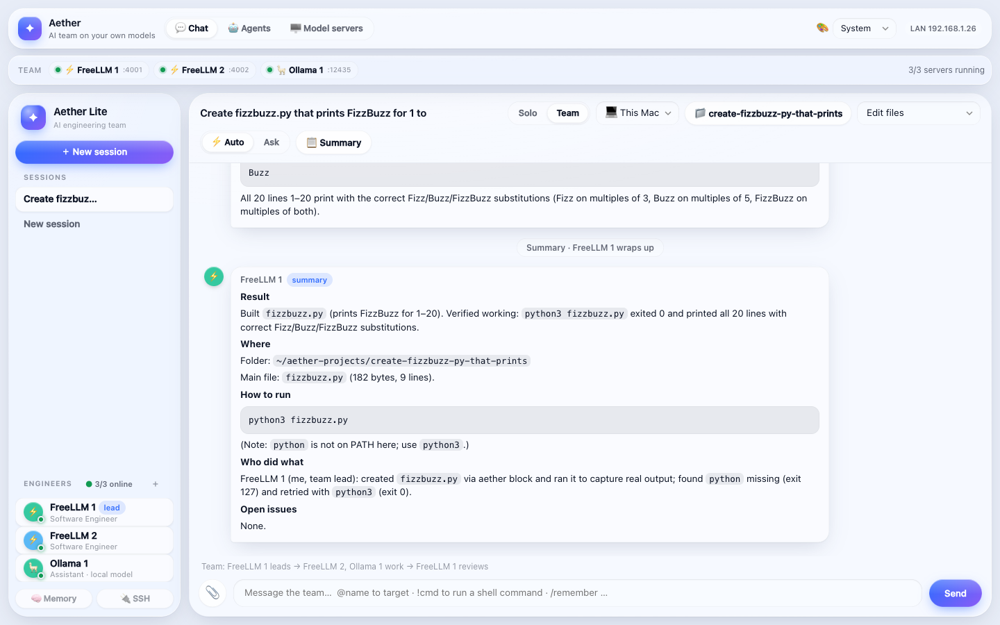
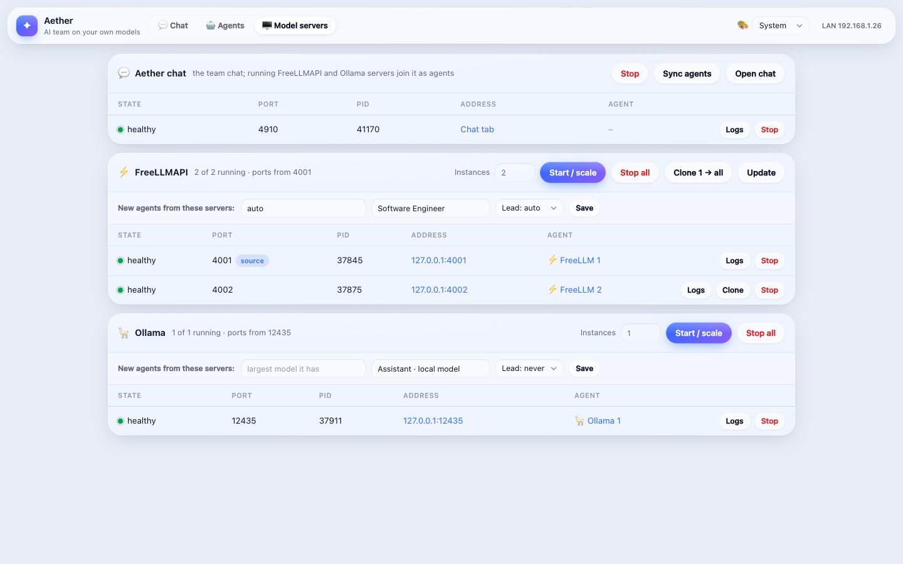
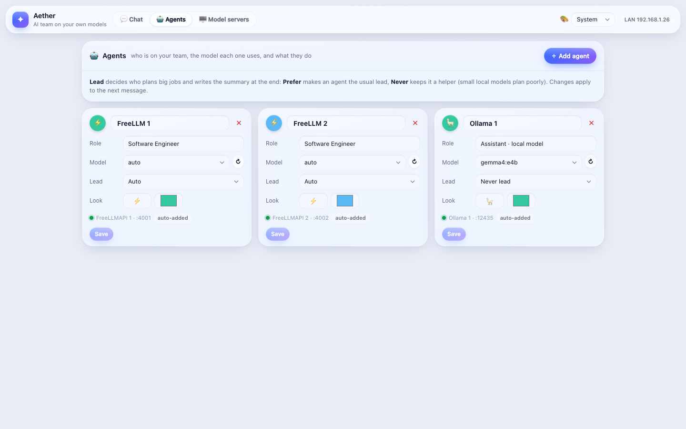
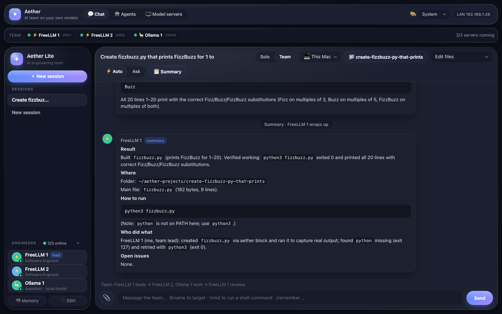
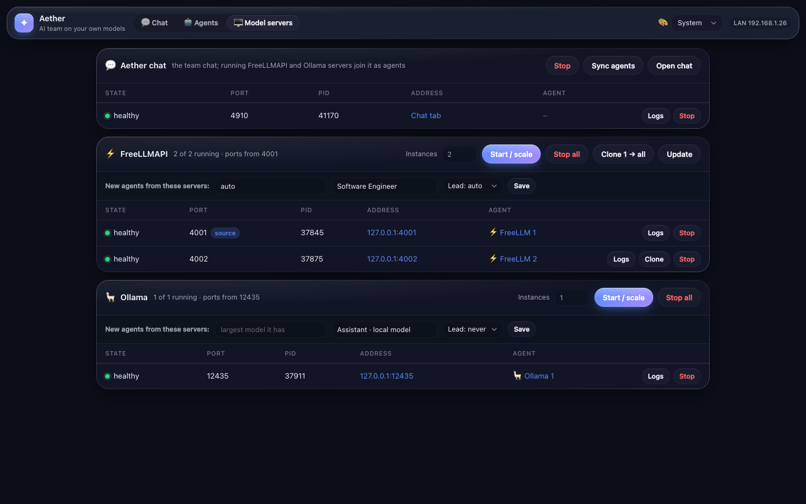

# Aether AI agents: FreeLLMAPI + Ollama + Aether team chat

Run a team of AI coding agents on your own machines. One command (or a web
control panel) starts several [FreeLLMAPI](https://github.com/tashfeenahmed/freellmapi)
and [Ollama](https://ollama.com) instances on consecutive ports, one per agent,
and the [Aether](https://github.com/manojbarot1/aether-code) team chat in the
browser with those instances as its engineers.



- **FreeLLMAPI agents** (`:3001`, `:3002`, …) route each request to free LLM
  providers, with fallback when one is rate-limited. Configure agent 1 once;
  the others start as copies.
- **Ollama instances** (`:11435`, …) serve local models.
- **Aether chat** turns every running instance into an engineer: a lead plans
  the job, helpers do the work, and the lead writes a summary at the end.
- **Control panel** (`:3900`) starts, scales and stops everything, edits
  agents, and hosts the chat. Linux and macOS.

## Documentation

| Guide | What is in it |
|---|---|
| [docs/INSTALL.md](docs/INSTALL.md) | Requirements and step-by-step installation on macOS, Debian and Ubuntu, first run, first FreeLLMAPI login. |
| [docs/CONFIGURATION.md](docs/CONFIGURATION.md) | `agents.conf` vs `agents.local.conf`, every setting, opening the panel to your network, security. |
| [docs/TEAM-JOBS.md](docs/TEAM-JOBS.md) | How the chat runs your agents as a team on a project: sizing, the lead's plan and file ownership, what each agent sees, verification and repair rounds, and how to write a good request. |
| [docs/DEPLOY.md](docs/DEPLOY.md) | Step-by-step plan to deploy to another machine over SSH (`deploy/deploy-remote.sh`), copying agent data, starting at boot with systemd, updating, troubleshooting. |

## Quick start

```bash
git clone https://github.com/manojbarot1/aether-ai-agents.git
cd aether-ai-agents
cp agents.local.conf.example agents.local.conf   # set LAN_IP; optional
./llm start freellm 1 aether panel               # first run clones + builds FreeLLMAPI
```

Open `http://localhost:3001`, create the FreeLLMAPI admin account and add your
provider keys (see [First login](docs/INSTALL.md#7-first-login-freellmapi)). Then:

```bash
./llm start freellm 5 ollama 1 aether panel      # 3002-3005 start as copies of 3001
```

and open **http://localhost:3900**. Requirements: Node.js `>=20.18 <25`, npm,
git, curl, Python 3.10+, zsh; Ollama for local models. Details in
[docs/INSTALL.md](docs/INSTALL.md).

## Screenshots

| Model servers | Agents |
|---|---|
|  |  |
| **Chat (dark)** | **Model servers (dark)** |
|  |  |

(The screenshots come from a demo run on alternate ports, 4001/4002/12435.)

## Command line

```bash
./llm start freellm 5             # FreeLLMAPI on 3001-3005
./llm start ollama 2              # Ollama on 11435-11436
./llm start freellm 5 ollama 2    # both at once
./llm start aether panel          # chat + control panel on http://localhost:3900
./llm status                      # every instance: state, pid, URLs
./llm stop                        # stop everything
```

| Command | What it does |
|---|---|
| `./llm start <service> N …` | Makes exactly N instances of each listed service run. Running ones are left alone, missing ones start, extra ones stop (`./llm start freellm 2` after 5 scales down). Services: `freellm`, `ollama`, `aether`, `panel`. |
| `./llm start freellm N --update` | `git pull` and rebuild FreeLLMAPI first. |
| `./llm stop [service\|all] [N\|:port]` | Stop everything, one service, its first N instances, or one port: `./llm stop freellm :3004`. |
| `./llm status [service]` | Table of instances. `--json` for scripts. |
| `./llm sync` | Register running FreeLLMAPI and Ollama instances as Aether engineers (runs by itself after `start`/`stop` while Aether is up). |
| `./llm clone [:port]` | Copy FreeLLMAPI agent 1 onto the other agents (see below). |
| `./llm logs <service> <port> [lines]` | Tail one instance's log. |
| `./llm update` | `git pull` + rebuild FreeLLMAPI; restart agents to use it. |

The old scripts still work: `./start.sh N`, `./stop.sh`, `./status.sh` and
`./clone.sh` call `./llm` for FreeLLMAPI.

## The control panel

```bash
./llm start freellm 5 ollama 1 aether panel   # then open http://localhost:3900
```

- **💬 Chat** is Aether itself (sessions, Team mode, memory, approvals), with
  your running FreeLLMAPI and Ollama instances as engineers. The **Team** bar
  above it shows every engineer and whether the instance behind it is running
  (green), stopped (red) or not one of these services (blue). When some are
  stopped, its **Start** button starts just enough instances for them.
  **📁** picks the working folder, **📎** attaches files (saved in
  `<working folder>/attachments/`). When a job finishes, the lead writes a
  **📋 Summary** (result, where, how to run, who did what, open issues).
- **🤖 Agents** edits every agent: name, role, model (loaded from its server),
  **Lead** (*Auto*, *Prefer* = usual lead, *Never* = helper only), avatar and
  colour. **＋ Add agent** adds one on any FreeLLMAPI/Ollama server or
  OpenAI-compatible URL.
- **🖥 Model servers** starts, scales and stops each server, clones FreeLLMAPI
  agent 1, updates FreeLLMAPI, syncs agents and shows any instance's log. Every
  button runs the matching `./llm` command and shows its output.
- **🎨** picks a theme (System, Light, Dark, Midnight, Ocean, Forest, Sunset,
  Graphite, Rose, Sand) for the panel and the chat.

Links: `http://localhost:3900/#chat`, `#agents` and `#servers`.

Behind the page, Aether runs as its own server on `127.0.0.1:3910`
(aether-code's browser mode, `web.py`); the panel serves it at `/chat/`, so you
never open that address yourself. It shares `~/.aether-lite` with the Aether
desktop app. To use the panel from other devices, see
[Opening the panel to your network](docs/CONFIGURATION.md#opening-the-panel-to-your-network).

### Engineers from your instances

Every running instance becomes an Aether engineer, kept in step automatically:

| Instance | Engineer | Model | Key |
|---|---|---|---|
| FreeLLMAPI `:3001` … | `FreeLLM 1` … | `auto` (FreeLLMAPI's router) | that agent's unified API key |
| Ollama `:11435` … | `Ollama 1` … | the largest model it has | none |

- New engineers are switched on in every session; ones whose instance stopped
  are removed. Your own engineers (Claude, Gemini, …) are never touched.
- If you already added an engineer for an instance yourself, sync uses yours
  instead of adding a second one; it only fills in the API key if yours has none.
- Ollama agents are added with Lead = *Never*: small local models make poor team
  leads. Change it in the Agents tab, or the default under Model servers → Ollama.
- Use `@FreeLLM 2 …` in the chat to pick an engineer, or Team mode to let
  Aether route work across all of them.

## FreeLLMAPI: set up agent 1, copy it everywhere

Configure only the first agent (login, provider keys, routing, license). A new
agent is created as a copy of agent 1, and `./llm clone` re-copies agent 1 onto
agents that already exist (each target restarts; its old DB is kept as
`freellmapi.db.bak`):

```bash
./llm start freellm 1      # set up http://localhost:3001: account, keys, license
./llm start freellm 5      # 3002-3005 start as copies of 3001
./llm clone                # later, after adding another key to 3001
```

A copy gets the dashboard login, provider keys, custom providers, models,
fallback chain, settings and the unified API key (every agent accepts the same
key). The Premium license, login sessions, request history and logs stay on
agent 1. Copying works because all agents share the encryption key in
`.app/.env`: keep that file, without it no agent can read its stored keys.

`CLONE=0 ./llm start freellm N` starts new agents empty; `CLONE_FROM=<port>`
copies from a different agent. Agents sharing a provider key share its free
quota upstream, so expect more 429s (which the router fails over on) than the
per-agent dashboard numbers suggest.

## Ollama notes

- Instances use ports from `OLLAMA_BASE_PORT` (11435); 11434 is left to the
  Ollama app or system service.
- All instances share one models folder (`~/.ollama/models`, or
  `OLLAMA_MODELS`): `ollama pull` once. On Linux with the Ollama system service,
  see [Ollama models on Linux](docs/DEPLOY.md#ollama-models-on-linux).
- Each instance loads models into memory separately: 3 instances running the
  same 8B model use roughly 3x the RAM.
- Point a client at `http://<LAN_IP>:11435/v1` (OpenAI-compatible) or
  `http://<LAN_IP>:11435` (native Ollama API).

## Layout

```
llm                            the command
common.sh                      shared code for llm and the wrapper scripts
agents.conf                    shared defaults (committed)
agents.local.conf              this machine's settings: LAN IP, panel token (gitignored)
agents.local.conf.example      template for agents.local.conf
panel/                         web control panel (server.mjs + index.html)
aether-sync.py                 running instances -> Aether engineers
clone-db.cjs                   copies FreeLLMAPI agent 1's DB onto another agent
deploy/deploy-remote.sh        deploy to another machine over SSH
deploy/freellmapi-agents.service   systemd user unit (start at boot)
docs/                          guides and screenshots
.app/                          FreeLLMAPI checkout + build (gitignored)
.app/.env                      ENCRYPTION_KEY shared by all FreeLLMAPI agents
.runtime/agent-<port>/         FreeLLMAPI agent: data/freellmapi.db, server.log, server.pid
.runtime/ollama-<port>/        Ollama instance: server.log, server.pid
.runtime/aether-<port>/        Aether chat: server.log, server.pid
.runtime/panel-<port>/         control panel: server.log, server.pid
.aether-code/                  aether-code checkout (gitignored; AETHER_CODE_DIR)
```

Stopping an instance keeps its data; delete its `.runtime` folder to reset it.
Health checks: FreeLLMAPI `/livez` (`/readyz` stays 503 until an agent has a
provider key), Ollama `/api/version`, Aether `/healthz`, panel `/api/ping`.

## Security

FreeLLMAPI and Ollama listen on every interface by default (`BIND_HOST=0.0.0.0`)
so other devices can use them. FreeLLMAPI dashboards need their login and `/v1`
needs the unified API key, but **the Ollama API has no authentication**: use a
trusted network, or `BIND_HOST=127.0.0.1`. The panel and the chat can run
commands and edit files on the machine, so they stay on `127.0.0.1` unless you
set both `PANEL_HOST` and a `PANEL_TOKEN`. Never commit `agents.local.conf`,
`.app/.env` or `.runtime/` (all gitignored): they hold tokens and provider keys.
